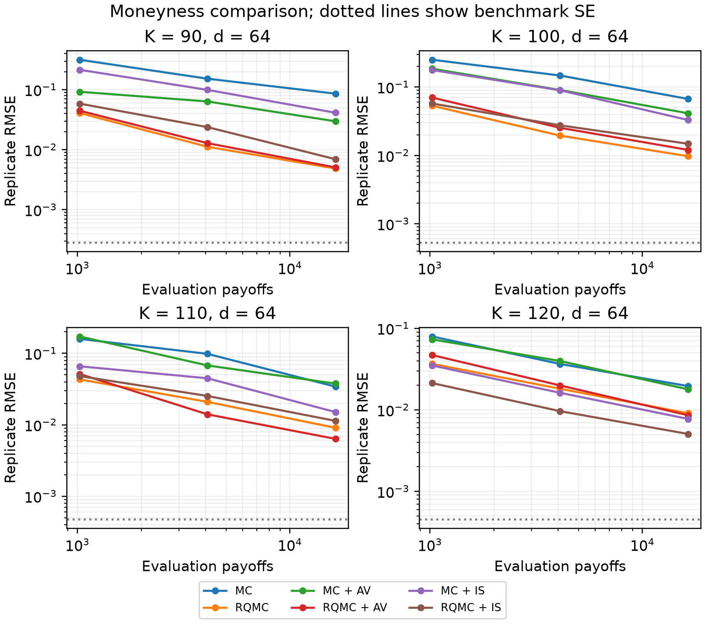

# QF4204: Monte Carlo and Quasi-Monte Carlo for Asian option pricing

An undergraduate quantitative finance project comparing Monte Carlo (MC) and
randomised quasi-Monte Carlo (RQMC) for pricing discretely monitored arithmetic
Asian calls under Black–Scholes. RQMC uses independently scrambled Sobol’ nets.
Both samplers are evaluated alone and with antithetic variates (AV) or Gaussian
importance sampling (IS).

The study covers ten contracts varying strike and monitoring frequency, with
three matched payoff-evaluation budgets and 32 independent replicates per
comparison. Each contract has an independent numerical benchmark and a separate
IS pilot. Performance is assessed through RMSE, estimator variance and runtime.

## Key findings

- Baseline RQMC has lower measured RMSE than baseline MC throughout the tested grid.
- MC antithetics are particularly effective for the in-the-money contracts.
- IS reduces measured variance for both samplers at the highest tested strike,
  but increases RQMC variance at lower strikes at the largest evaluation budget.

These findings depend on the contract and evaluation budget. Runtime comparisons
include IS pilot costs and do not establish a ranking at equal runtime.



*Convergence at 64 monitoring dates, using 32 independent replicates per method
at each matched evaluation budget. Dotted lines indicate benchmark standard errors.
IS tuning costs are additional to the evaluation budgets shown.*

See the [project report](report/QF4204_Report.pdf) for the methodology, full results
and limitations.

## Installation and usage

The recorded experiments use **Python 3.14.2**, with package versions pinned in
[`requirements.txt`](requirements.txt). Run commands from the repository root.

On macOS or Linux:

```sh
python3 -m venv .venv
source .venv/bin/activate
python -m pip install -r requirements.txt
```

On Windows PowerShell:

```powershell
python -m venv .venv
.venv\Scripts\Activate.ps1
python -m pip install -r requirements.txt
```

### Tests

```sh
python -m unittest discover -s tests -v
```

Checks cover analytical pricing cases, antithetic pairing, IS likelihood ratios,
sampling uncertainty and reproducibility.

### Main experiment

```sh
python -m src.experiments
```

Runs the ten-contract sweep with all six methods, including benchmarks and IS
tuning, and saves replicate estimates, summaries, figures and tables. Each run
creates a new folder such as `results/sweep-2/`, preserving existing results.
The full sweep is computationally intensive. Saved results can be used directly
for plotting and analysis.

## Repository structure

| Path | Contents |
|---|---|
| [`src/models.py`](src/models.py) | Contract parameters, exact Black–Scholes paths and discounted payoffs |
| [`src/pricing.py`](src/pricing.py) | Sampling, estimators, variance reduction and pilot tuning |
| [`src/experiments.py`](src/experiments.py) | Experiment settings, execution and summaries |
| [`src/plotting.py`](src/plotting.py) | Figures and tables generated from saved results |
| [`tests/`](tests/) | Mathematical and reproducibility checks |
| [`results/`](results/) | Saved settings, replicate estimates, summaries and figures |
| [`report/`](report/) | Report and supporting figures and tables |

## Configuration and saved results

Editable settings are grouped at the top of `src/experiments.py`.

| Setting | Controls |
|---|---|
| `SETTINGS` | Contract parameters, methods, payoff budgets, replications, benchmark size and IS pilot |
| `SWEEP_SETTINGS` | Strike and monitoring-date grids, sweep seed and extra benchmark replicates |
| `VALIDATION_SETTINGS` | Separate European-call and zero-volatility checks |

Methods are `mc`, `rqmc`, `mc_av`, `rqmc_av`, `mc_is` and `rqmc_is`.
Budgets count evaluation payoffs, with each antithetic pair counting as two.
IS tuning costs are recorded separately. Sobol’ base-point counts must be powers
of two, and RQMC uncertainty is calculated across independent scrambles.
If changing the contract grid, update `benchmark_extensions` to match it.

The main results are in [`results/sweep/`](results/sweep/), including the
[summary CSV](results/sweep/summary.csv) and
[monitoring-frequency comparison](results/sweep/dimension_comparison.png).
Analytical validation results are in [`results/validation/`](results/validation/).

Each sweep contains `settings.json` and a combined `summary.csv`. Contract
subfolders contain their own settings, pilot diagnostics, summary and
`replicates.csv`, which records benchmark and evaluation estimates, seeds,
payoff counts and timings.

## Reproducing the results

Numerical results should reproduce with the same code, settings, seeds and
software environment. Timings can vary.

### Analytical validation

```python
from src.experiments import run_validation
from src.plotting import export_validation_tables

validation_folder = run_validation()
export_validation_tables(validation_folder, validation_folder)
print(validation_folder)
```

Creates a new validation folder with European-call and zero-volatility results.

### Regenerate report figures and tables

Uses the supplied data without rerunning simulations and replaces generated
figures and tables in the report folders.

```python
from src.plotting import (
    plot_sweep,
    export_sweep_tables,
    export_pilot_table,
    export_validation_tables,
    plot_appendix_figures,
)

plot_sweep("results/sweep", "report/figures")
export_sweep_tables("results/sweep", "report/tables")
export_pilot_table("results/sweep", "report/tables/sweep_pilot.tex")
export_validation_tables("results/validation", "report/tables")

plot_appendix_figures(
    "results/sweep/strike-120-dates-64", "report/figures", budget=16384
)
```

### Reproduce the saved sweep

Loads the saved configuration, including seeds and benchmark refinements,
and runs the simulations in a new output folder.

```python
import json
from pathlib import Path
from src.experiments import run_sweep
from src.plotting import plot_sweep, export_sweep_tables

saved = json.loads(Path("results/sweep/settings.json").read_text())
new_folder, summary = run_sweep(saved["experiment"], saved["sweep"])
plot_sweep(new_folder)
export_sweep_tables(new_folder)
```

